<h1 align="center">Weather Clock</h1>

<p align="center"><b>Fairly decent alternative firmware for $5 ESP32-based weather gadget with 240x240 LCD screen</b></p>

<p align="center">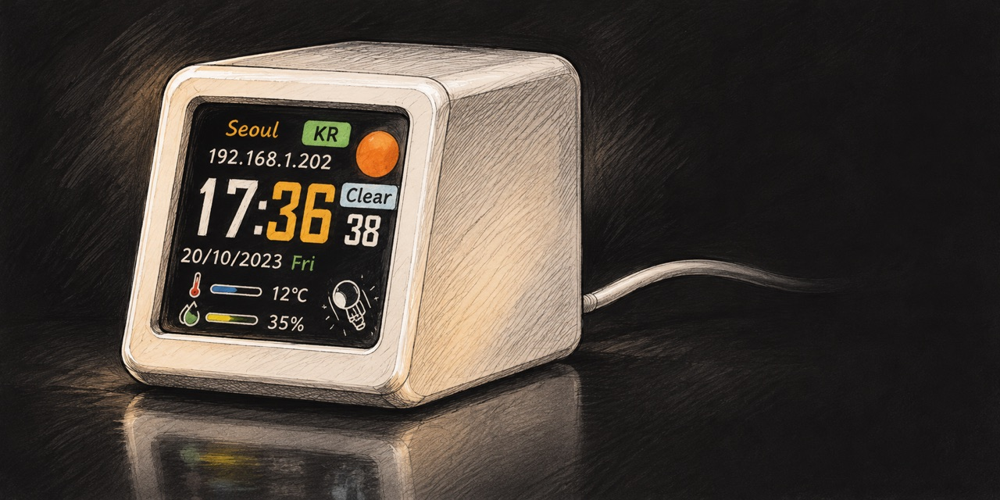</p>

A weather and news-focused firmware for the cheap clones of a Weather clock: the **[GeekMagic SmallTV-Ultra](https://geekmagicclock.com)** (ESP8266, 240×240 screen) and its look-alikes. It turns the little desk clock into a weather station with 20+ animated faces, a web panel you open from any phone or computer, and updates over Wi-Fi.

Weather Clock is a fork of [smalltv-pomodoro](https://github.com/davicorrea0/smalltv-pomodoro) by davicorrea0 (GPL-3.0). See [Credits](#credits).

**Where to get one:** the GeekMagic SmallTV-Ultra is sold by [GeekMagic](https://geekmagicclock.com), and clones of it are sold on AliExpress and similar shops, often as a "portable mini weather screen" ([AliExpress search](https://www.aliexpress.com/w/wholesale-portable-mini-weather-screen.html)). Check that the listing is the ESP8266 model with a 240×240 screen.

> **Note on clones:** this project also works with compatible clones of the GeekMagic SmallTV-Ultra. This project does not condone any alleged intellectual property theft of hardware designs. Where you can, buy the original from [GeekMagic](https://geekmagicclock.com).

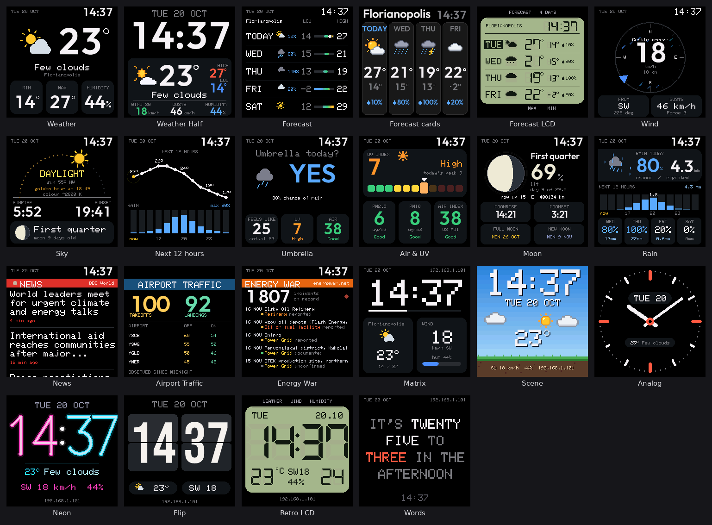

<sub>Every screen in this README is drawn by the project's simulator, which compiles the same drawing code as the firmware.</sub>

> ⚠️ For the **SmallTV-Ultra (ESP8266)** only. Do not flash it on the SmallTV Pro (ESP32) or other models.

## Contents

- [Clock faces](#clock-faces)
- [Features](#features)
- [Install](#install)
- [First-time setup](#first-time-setup)
- [The web panel](#the-web-panel)
- [Updates](#updates-in-one-tap)
- [Optional helper computer](#optional-helper-computer)
- [If something goes wrong](#if-something-goes-wrong)
- [For developers](#for-developers)
- [Credits](#credits)
- [Roadmap and to-do list](docs/ROADMAP.md)
- [License](#license)

## Clock faces

There are 22 faces. Every GIF below is recorded from the simulator, which runs the same drawing code as the clock, so this is how they move on the real screen. The animations run on the clock itself: no video files, each frame is drawn live by the ESP8266. Screens also fade to black and back when the clock changes face.

### Made for Weather Clock

These faces are new in Weather Clock, and all of them are animated.

<table>
<tr>
<td align="center" valign="top" width="33%">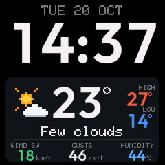<br><b>Weather Half</b><br><sub>Half clock, half weather: temperature, high and low, wind, gusts and humidity. Ships as a face pack</sub></td>
<td align="center" valign="top" width="33%">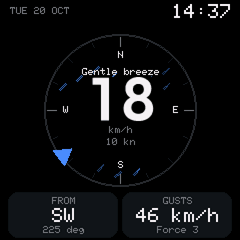<br><b>Wind</b><br><sub>Compass with an arrow that sways with the gusts, speed, direction and Beaufort force</sub></td>
<td align="center" valign="top" width="33%">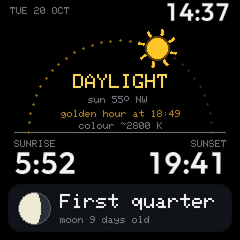<br><b>Sky</b><br><sub>The sun moving along its path from sunrise to sunset, golden hour and the moon phase</sub></td>
</tr>
<tr>
<td align="center" valign="top" width="33%">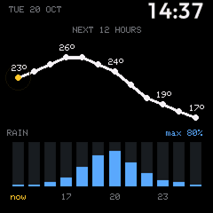<br><b>Next 12 hours</b><br><sub>Temperature curve drawing itself and hourly rain chance bars</sub></td>
<td align="center" valign="top" width="33%">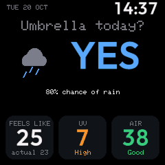<br><b>Umbrella</b><br><sub>"Umbrella today?" with falling rain, plus feels-like, UV and air quality</sub></td>
<td align="center" valign="top" width="33%">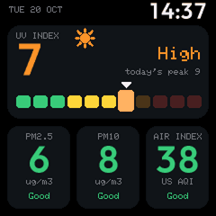<br><b>Air & UV</b><br><sub>UV index with today's peak, PM2.5, PM10 and air index</sub></td>
</tr>
<tr>
<td align="center" valign="top" width="33%">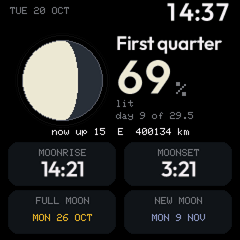<br><b>Moon</b><br><sub>Phase and how much is lit, moonrise and moonset, next full and new moon</sub></td>
<td align="center" valign="top" width="33%">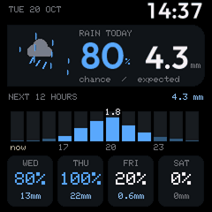<br><b>Rain</b><br><sub>Rain today (chance and mm), the next 12 hours and the coming days</sub></td>
<td align="center" valign="top" width="33%">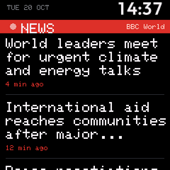<br><b>News</b><br><sub>Scrolling breaking news headlines. Needs a helper computer</sub></td>
</tr>
<tr>
<td align="center" valign="top" width="33%">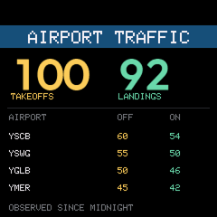<br><b>Airport Traffic</b><br><sub>Takeoffs and landings so far today at nearby airports. Needs a helper computer</sub></td>
<td align="center" valign="top" width="33%">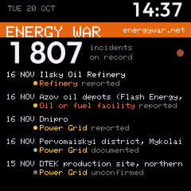<br><b>Energy War</b><br><sub>Latest attacks on energy infrastructure from EnergyWar.net. Needs a helper computer</sub></td>
</tr>
</table>

### From SmallTV Pomodoro, reworked

These 11 faces come from [SmallTV Pomodoro](https://github.com/davicorrea0/smalltv-pomodoro). In the original they showed Pomodoro focus counts and were static. We replaced the Pomodoro parts with weather, wind and humidity, and animated the weather icons on the Weather and Forecast faces.

<table>
<tr>
<td align="center" valign="top" width="33%">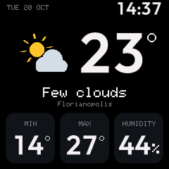<br><b>Weather</b><br><sub>Big temperature and cards. <i>We animated the weather icon</i></sub></td>
<td align="center" valign="top" width="33%">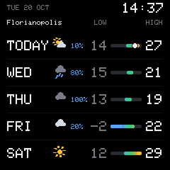<br><b>Forecast</b><br><sub>Today and 4 days with low-to-high bars. <i>We animated the icons</i></sub></td>
<td align="center" valign="top" width="33%">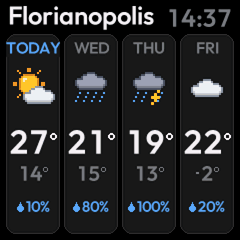<br><b>Forecast cards</b><br><sub>Four days as cards. <i>We animated the icons</i></sub></td>
</tr>
<tr>
<td align="center" valign="top" width="33%">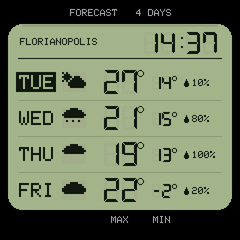<br><b>Forecast LCD</b><br><sub>Four days on a retro LCD. <i>We animated the pictograms</i></sub></td>
<td align="center" valign="top" width="33%">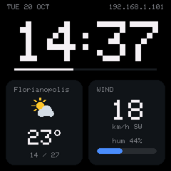<br><b>Matrix</b><br><sub>Pixel clock. <i>Focus counts replaced by weather and wind cards</i></sub></td>
<td align="center" valign="top" width="33%">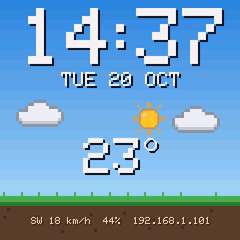<br><b>Scene</b><br><sub>Was the Pomodoro tomato scene. <i>Now a weather landscape</i></sub></td>
</tr>
<tr>
<td align="center" valign="top" width="33%">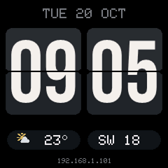<br><b>Flip</b><br><sub>Flipping cards with the Bebas Neue font. <i>Now shows weather and wind</i></sub></td>
<td align="center" valign="top" width="33%">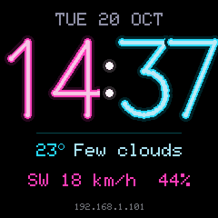<br><b>Neon</b><br><sub>Glowing tubes. <i>Now shows weather, wind and humidity</i></sub></td>
<td align="center" valign="top" width="33%">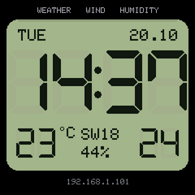<br><b>Retro LCD</b><br><sub>80s digital watch. <i>Now shows wind and humidity</i></sub></td>
</tr>
<tr>
<td align="center" valign="top" width="33%">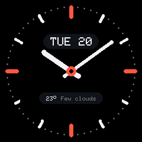<br><b>Analog</b><br><sub>Baton hands and bold markers, with the weather</sub></td>
<td align="center" valign="top" width="33%">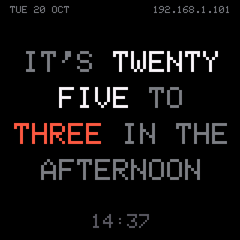<br><b>Words</b><br><sub>The time spelled out in words</sub></td>
</tr>
</table>

More faces can be installed from the panel without updating the firmware (small `.json` face packs, like Weather Half). Format: [docs/FACE_PACKS.md](docs/FACE_PACKS.md) and the [`faces/`](faces) folder.

## Features

A quick tour of everything the clock does, with screens from the simulator and the web panel.

### Live weather, no account needed

Weather comes straight from [Open-Meteo](https://open-meteo.com/) every 15 minutes: temperature, feels-like, humidity, wind speed, gusts and direction, rain chance and millimetres, UV index, air quality (PM2.5, PM10 and US AQI), sunrise and sunset, the moon, and a 5-day forecast. No API key or sign-up. The panel's Clock page shows the same data at a glance.

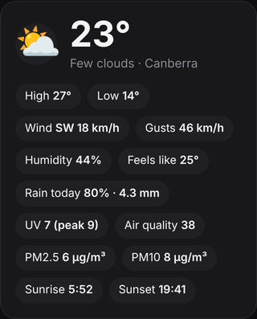

### Choose your city, and the time zone follows

Search for your town under *Settings → Weather*. Picking it also sets the time zone with its daylight-saving rules, so the clock is right after DST changes without you touching it. The same card switches between °C and °F and turns the rain warning on or off.

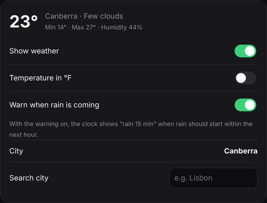

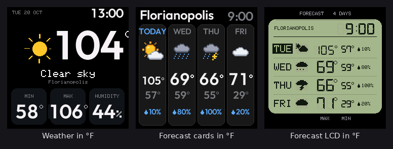

### Rain warning

When rain is due within the next hour, faces show how many minutes away it is, using Open-Meteo's 15-minute rain forecast.

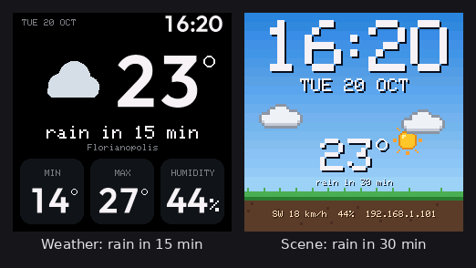

### Animated faces and smooth changes

Weather icons drift and glow, rain falls, the wind arrow sways with the gusts, the Sky face tracks the sun, and the Flip face really flips. Every change of screen fades to black and back, so faces never tear while they redraw.

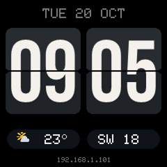 

The Scene face is a pixel-art landscape that follows the time of day and the weather:

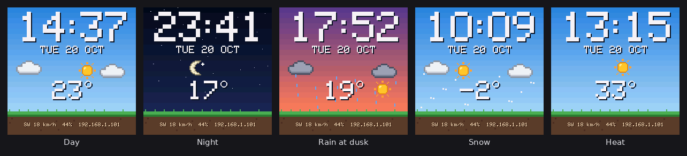

### Face rotation

Under *Clock → Appearance*, tick the faces you want and choose how often they change (every 1 minute to every hour). With *What to show* set to **Alternate clock and album**, photos and radar or plane cards play between faces, each for the number of seconds you set. You can also change the digit colour and switch to 12-hour time.

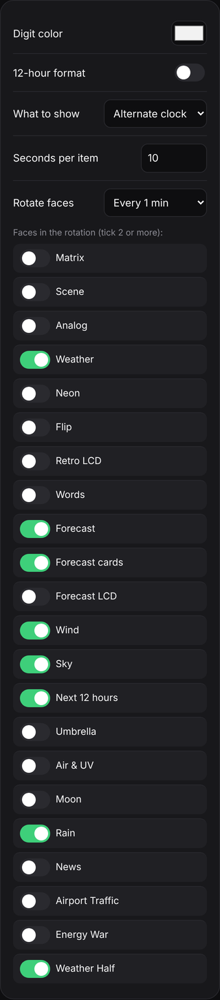

### More faces without updating the firmware

Besides the built-in faces, the clock accepts small `.json` face packs. Install one under *Clock → More faces* by picking the file (and its preview image). It is stored on the clock and works straight away. Weather Half is one of them. Making your own: [docs/FACE_PACKS.md](docs/FACE_PACKS.md).

### Photo and GIF album

Upload photos and animated GIFs on the *Album & radar* page. Photos are cropped to 240×240 in your browser before they are sent, and the storage bar shows how much of the 2 MB is used. Oversized GIFs are skipped instead of freezing the clock.

### Rain radar (Australia)

With the optional helper running on another computer, the clock shows the Bureau of Meteorology rain radar for the last 30 minutes between faces, plus a card when BoM issues a warning nearby. Pick the radar station and range on the *Album & radar* page. The panel's Clock page plays the same radar loop.

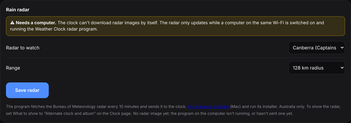

### Lightning, nearby aircraft and military aircraft cards

The optional **WeatherClockRadar** helper also makes several 240×240 album cards and sends them to the clock:

- **Lightning:** shows an official Bureau of Meteorology thunderstorm warning for the chosen Australian location. It is warning detection, not live lightning-strike detection, and the card is hidden when no local warning is active.
- **Nearby Aircraft:** shows aircraft detected within 100 km, using public ADS-B positions.
- **Military Aircraft:** shows military-registered aircraft detected within 250 km. The recent-sighting window is configurable from 1 to 1,440 minutes (60 minutes by default), and the card is removed from rotation when no aircraft qualifies.
- **Flights Today:** counts observed takeoffs and landings at airports within 200 km. These are observed ADS-B transitions, not guaranteed complete airport totals.
- **Weather warnings:** shows nearby BoM warning cards and removes them when the warning is no longer active.

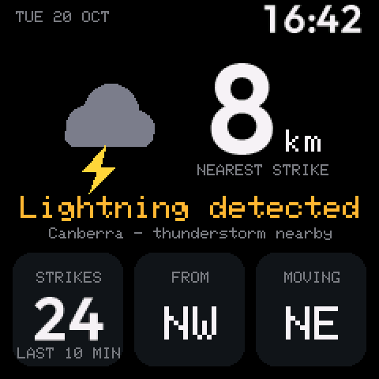<br><sub>Design preview of the animated "Lightning detected" screen. The numbers are sample values; today's helper shows the BoM warning text.</sub>

These are album cards rather than built-in faces, so they do not appear in the face checkbox list. Set *Clock → What to show* to **Alternate clock and album** to include them. They update only while the helper computer is on, awake and connected to the same network as the clock. Public ADS-B coverage is incomplete, so aircraft can occasionally be missed.

### Brightness that follows the sun

Set the daytime brightness, then a lower night level. Night can follow your city's sunset and sunrise or fixed hours. Changes ramp smoothly instead of jumping.

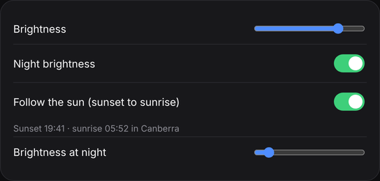

### Several clocks on one Wi-Fi

Weather Clock is built to run several clocks around the house. Each one keeps its own faces, rotation and album, and they find each other automatically on the same Wi-Fi (no setup or account).

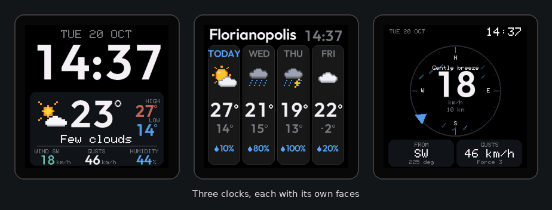

How it works:

1. **Give each clock a name and a number** under *Settings → System*, for example 1 Kitchen, 2 Office, 3 Bedroom. The name also shows on the start-up screen.
2. **Place them on the grid** under *Settings → My clocks*. Every clock on your Wi-Fi appears there; drag each one to the row and column where it sits (up to 10 × 10). Moving one clock in the grid updates the others too.
3. **Tap a clock to Identify it.** It shows its number, grid place, name and address in big digits for 10 seconds, so you know which is which. **Open** jumps straight to that clock's own panel.
4. **Each clock gets its own address:** `weatherclock.local`, `weatherclock-2.local`, `weatherclock-3.local` and so on, as well as its IP address.

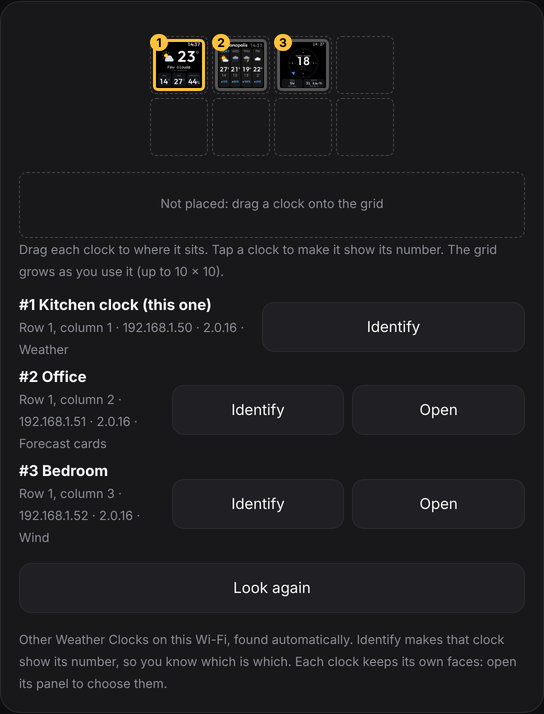

### Weather Clock WWW dashboard

[Weather Clock WWW](https://github.com/FPV-dB/weather-clock-www) is a home dashboard for all your clocks at once. It runs on any always-on computer on your Wi-Fi (Mac, PC or Raspberry Pi, Python only, nothing to install from the internet) and you open it in a browser.

**Tablets work really well for it.** An old Android tablet or iPad propped up in the kitchen or on a desk makes a great wall panel: open the dashboard, tap **Full screen**, and keep the tablet on its charger with the screen set to stay awake. It also works on a phone or a computer browser.

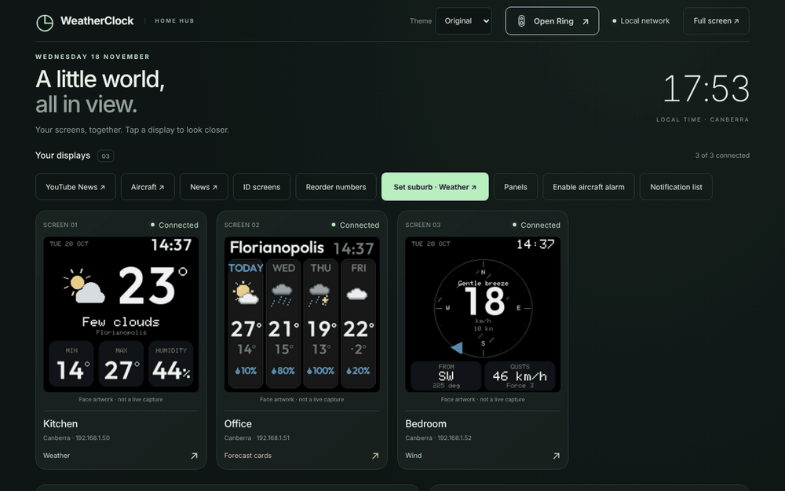

What it does:

- Shows every clock on your network as a tile with what it's displaying (face previews are artwork, not a live camera of the screen).
- Tap a clock to see its readings and change its brightness or face, or open its own panel.
- **ID screens** numbers your clocks 1, 2, 3… in your chosen order and makes each one show its number for 10 seconds; **Reorder numbers** changes that order.
- Local weather for a suburb you choose, a 7-day forecast, news and nearby aircraft, and the Desktop Radar plane screen if you have one.

<table><tr>
<td width="70%" valign="top">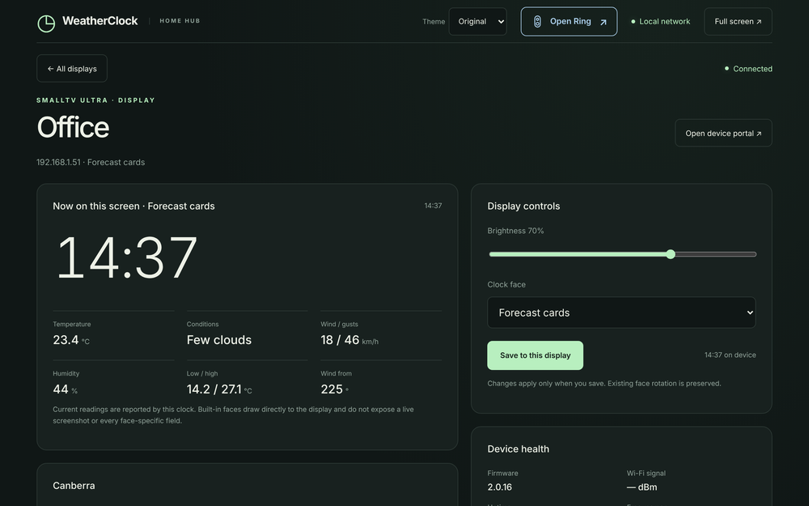<br><sub>One clock's page: readings, brightness and face</sub></td>
<td width="30%" valign="top">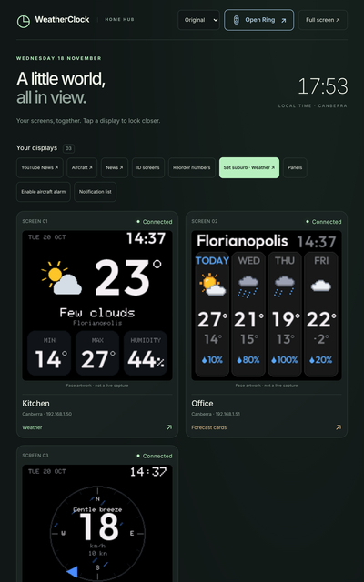<br><sub>Portrait tablet</sub></td>
</tr></table>

### Start-up screen

While it starts, the clock shows its name, the step it is on (Wi-Fi, then the time), and its address so you can open the panel.

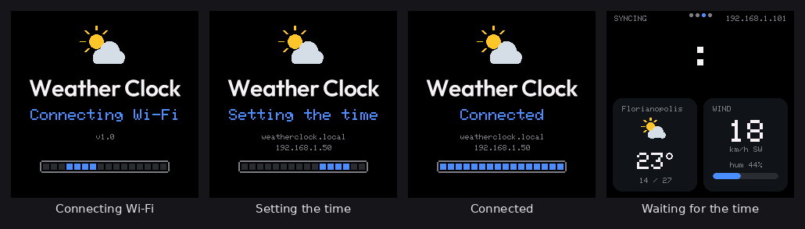

### Updates in one tap

When a new version is published, the panel shows what changed and an **Update now** button. The new firmware is signed and checked before the clock switches to it.

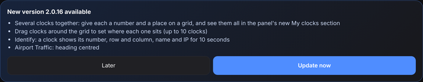

You can also use *Settings → Check for updates*. Manual update: download `weatherclock.bin` and its `.sig` file from [Releases](https://github.com/FPV-dB/WeatherClock/releases) and use *Settings → Update firmware*.

### Name, password, backup and gifts

*Settings → System* holds the clock's name and number, an optional panel password, **Back up** and **Restore backup** (settings, photos, GIFs and downloaded faces in one `.json` file, without passwords or Wi-Fi details), **Check for updates**, **Update firmware**, **Reset Wi-Fi**, and **Prepare as a gift**. That last one erases everything except the firmware, so the clock restarts with the first-install help for its new owner.

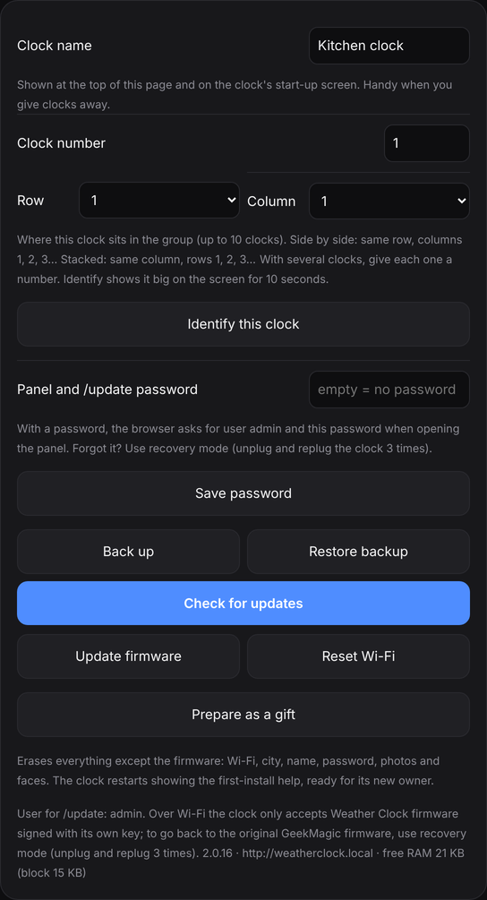

### Fixes for different screens

Panels vary between units. *Settings → Device screen* can swap the colour order, invert colours and rotate the picture 180°. A colour test shows which setting you need, and the anti-ghosting adjustment removes faint marks left by a face that stayed on for a long time.

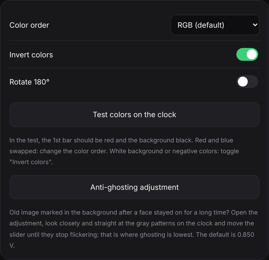

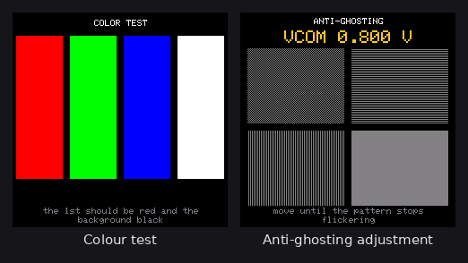

### Languages

English is the default for the screen and the panel. Portuguese and Spanish are still available under *Settings → Language*.

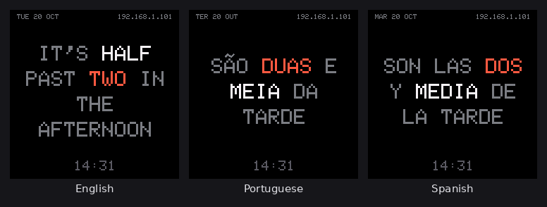

### Safe by design

Updates over Wi-Fi must carry this project's signature, and a corrupted file is refused while the current firmware keeps running. Other websites can't send commands to the clock, the optional password slows down repeated guesses, and recovery mode (unplug and replug 3 times) always lets you get back in. *Settings → Diagnostics* shows why the clock last restarted, the Wi-Fi signal and free memory. Details: [docs/TECHNICAL.md](docs/TECHNICAL.md).

## Install

You need the clock on your home **2.4 GHz** Wi-Fi and a computer or phone on the same network.

1. Download `weatherclock.bin` from the [latest release](https://github.com/FPV-dB/WeatherClock/releases/latest).
2. **From the original GeekMagic firmware:** open the clock's IP address in a browser, go to **Firmware Upgrade**, upload the `.bin` and wait for the restart.
   - If you see `ERROR[4]: Not Enough Space`, the factory update space on your unit is too small. First upload the loader [`smalltv-mod-loader.bin`](https://github.com/giovi321/smalltv-mod/releases/tag/v2.8.2) (giovi321/smalltv-mod v2.8.2), join its open Wi-Fi `SmallTV-Loader`, and upload `weatherclock.bin` at `http://192.168.4.1/update`.
3. **From smalltv-pomodoro or another firmware:** updates over Wi-Fi only accept firmware signed by the same project, so put the clock in [recovery mode](#if-something-goes-wrong) and upload `weatherclock.bin` there.
4. The clock restarts into Weather Clock and shows the setup screens below.

USB-C on the SmallTV-Ultra is power only. Flashing over a USB-to-serial adapter is only needed if a clock is completely dead: see [docs/RECOVERY.md](docs/RECOVERY.md).

## First-time setup

A new clock (or one reset with "Prepare as a gift") walks you through setup on its own screen. Each step alternates every 10 seconds between written steps and a big QR code.

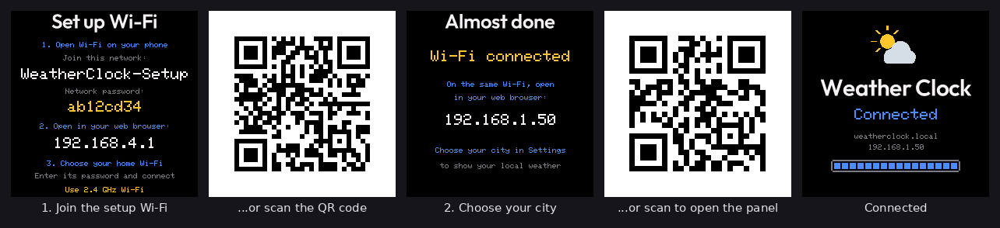

1. **Join the setup Wi-Fi.** On your phone, join `WeatherClock-Setup` with the password shown on the clock, or scan the QR code with the camera.
2. **Pick your home Wi-Fi.** The setup page opens by itself (or go to `http://192.168.4.1`). Choose your network and type its password. Only **2.4 GHz** networks work.
3. **Choose your city.** Once connected, the clock shows its address and a QR code for the panel. Open it, tap **Choose my city** and search for your town. The time zone is set at the same time.

The clock is then reachable at its IP address or at `http://weatherclock.local` (a second clock on the same network takes `weatherclock-2.local`, and so on).

## The web panel

The web panel was rebuilt for Weather Clock: weather at the top, every face as a live preview tile, tick boxes for the rotation, a radar page and the My clocks grid. Open the clock's address in any browser on the same Wi-Fi. Settings save as you change them, and the layout has its own design for phones and for computers.

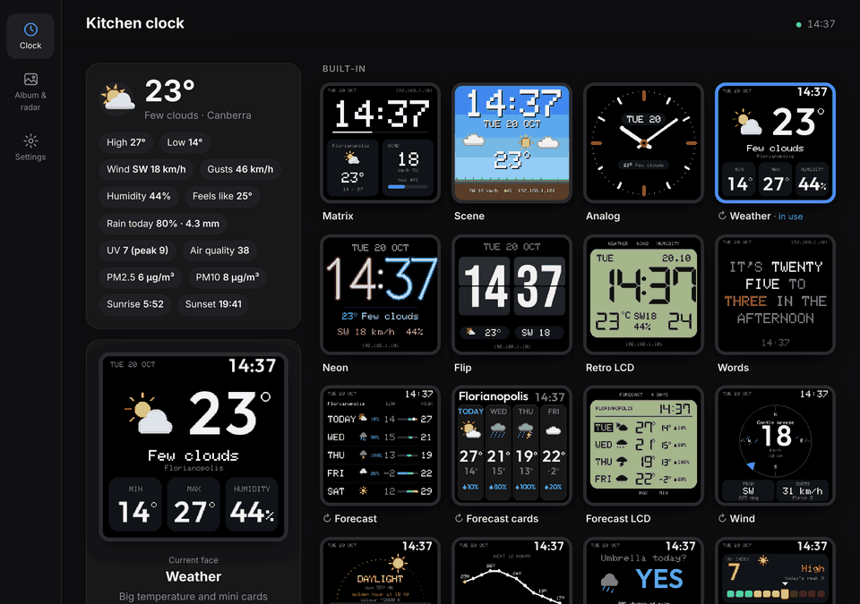

| Page | What you can do |
|---|---|
| **Clock** | See the current weather, pick a face, build the face rotation, choose the digit colour, 12/24-hour time and what to show (clock, album or both) |
| **Album & radar** | Upload photos and GIFs (photos are cropped to 240×240 in your browser), choose the rain radar and its range, see what is using storage |
| **Settings** | Language, city search, °C/°F, rain warning, brightness and night mode, screen colour fixes, time zone, **My clocks**, clock name and number, panel password, backup and restore, updates, Wi-Fi reset, "Prepare as a gift", diagnostics |

### Clock page

<table><tr>
<td width="72%" valign="top">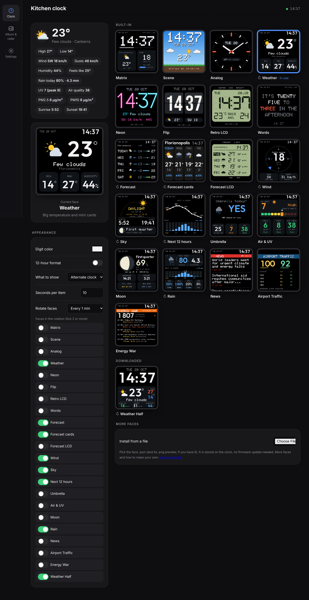</td>
<td width="28%" valign="top">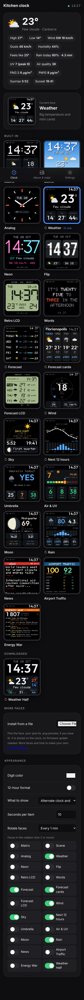</td>
</tr></table>

### Album & radar page

<table><tr>
<td width="72%" valign="top">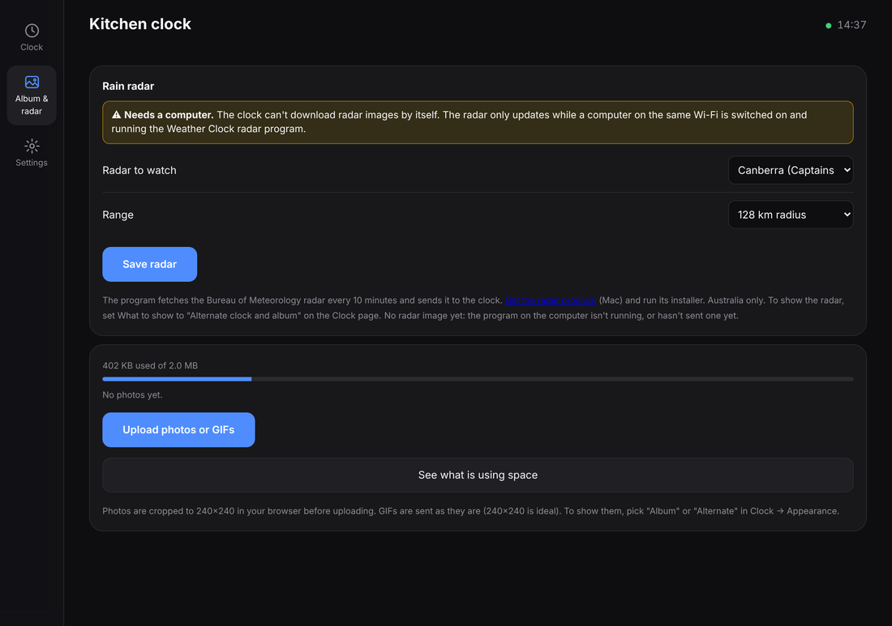</td>
<td width="28%" valign="top"></td>
</tr></table>

### Settings page

<table><tr>
<td width="72%" valign="top"></td>
<td width="28%" valign="top"></td>
</tr></table>

**Password:** *Settings → Panel and /update password* protects the panel (user `admin`). Forgot it? Use recovery mode.

## Optional helper computer

The clock fetches weather by itself and works fine on its own. A few extras need more memory, more data or more processing than the little ESP8266 can manage, for example decoding radar images or tracking aircraft. For those, a small script runs on another computer on the same Wi-Fi, does the heavy work and sends the result to the clock.

**What can run the helpers:** a Mac, a Windows PC, a Raspberry Pi or any Linux box. The scripts are plain Python 3. They were written and tested on macOS (scheduled with launchd), and the same scripts run on Linux or a Raspberry Pi with cron or a systemd timer, or on Windows with Task Scheduler. A Raspberry Pi is a good always-on choice because it uses very little power. Helpers only update the clock while that computer is on and awake.

| Helper | What it adds | Status |
|---|---|---|
| **WeatherClockRadar** | BoM rain radar and warning cards, News, Nearby Aircraft, Military Aircraft, Flights Today and the Lightning warning card | Helper is working; public source package and installer still need to be added to this repository |
| **Energy War and Airport Traffic** | Data for the Energy War and Airport Traffic faces, every 15 minutes | [tools/energy-airport-mac](tools/energy-airport-mac/) |
| **Markets card** | A two-page album card with stocks, metals and Bitcoin, every 15 minutes | [tools/markets-card](tools/markets-card/) |

Cards made by helpers play between faces like photos in the album:


**Faces that need a helper:** News, Airport Traffic and Energy War. Without a helper running they have nothing new to show, and Airport Traffic is left out of the rotation until fresh data arrives. The radar, lightning, warning, nearby-aircraft, military-aircraft, Flights Today and markets screens are helper-generated album cards rather than faces. To show them, set *Clock → What to show* to **Alternate clock and album**.

## If something goes wrong

**Recovery mode:** unplug the clock and plug it back in **3 times in a row**, leaving it on for less than 30 seconds each time. On the third start it opens the `WeatherClock-Recovery` Wi-Fi. Join it and open `http://192.168.4.1` to upload any firmware (no password or signature needed), reset settings, or forget the Wi-Fi. *Restart normally* goes back to the clock.

- **Wrong colours or upside-down screen:** *Settings → Device screen* has colour order, invert and rotate options, plus a colour test.
- **No weather:** check that a city is chosen and look at *Settings → Diagnostics* for a weak Wi-Fi signal (below about −75 dBm).
- **Back to the original firmware:** open recovery mode and upload GeekMagic's `.bin` from [GeekMagicClock/smalltv-ultra](https://github.com/GeekMagicClock/smalltv-ultra).
- **Completely dead clock:** reflash over USB-to-serial, see [docs/RECOVERY.md](docs/RECOVERY.md).

## For developers

| Folder | Contents |
|---|---|
| `weatherclock/` | Firmware (Arduino / ESP8266). One `face_*.cpp` per face, registered in `faces_list.h` |
| `web/` | The web panel (`web/index.html`), served from GitHub Pages |
| `sim/` | Screen simulator: compiles the drawing code on a PC and saves every screen as PNG, with redraw tests |
| `faces/` | Downloadable face packs and their previews |
| `assets/` | Pixel art sprites as text files |
| `tools/` | Optional helper scripts |
| `docs/` | Guides and README images |

Build the firmware:

```sh
arduino-cli core install esp8266:esp8266 --additional-urls https://arduino.esp8266.com/stable/package_esp8266com_index.json
arduino-cli lib install "Adafruit GFX Library@1.13.0" "Adafruit ST7735 and ST7789 Library@1.11.0" "ArduinoJson@7.4.3"
sim/build.sh   # generates assets.h and the panel, tests every screen in the simulator
./build.sh     # builds the firmware into build/
```

The simulator needs [Zig](https://ziglang.org/) (`pip install ziglang` works) or a 32-bit `g++`. Set `GFX` and `JSON` to the Adafruit GFX and ArduinoJson source folders if they are not in the Arduino libraries folder. Making a new face: [docs/MAKING_A_FACE.md](docs/MAKING_A_FACE.md). Flash layout, security and other internals: [docs/TECHNICAL.md](docs/TECHNICAL.md).

## Roadmap

Planned work, including **local sensor modules** (ESP32 boards with BME280 and other sensors around the house, set up the way you want), is in [docs/ROADMAP.md](docs/ROADMAP.md).

## Credits

**Based on [SmallTV Pomodoro](https://github.com/davicorrea0/smalltv-pomodoro) v1.23.5 by [davicorrea0](https://github.com/davicorrea0)** (GPL-3.0). Much of the code comes from that project: the face engine and many faces, the web panel, face packs, signed updates, recovery mode and the security work. Weather Clock removed the Pomodoro timer and added the weather faces, animations, setup screens, multi-clock support and the helper scripts. Thank you!

**Data sources**

- Weather, air quality and city search: [Open-Meteo](https://open-meteo.com/) (CC BY 4.0)
- Rain radar and warnings: [Australian Bureau of Meteorology](http://www.bom.gov.au/)
- Aircraft positions: [adsb.fi](https://adsb.fi/) and [adsb.lol](https://adsb.lol/); routes: [adsbdb](https://www.adsbdb.com/)
- News headlines: public news RSS feeds
- Energy War face: [EnergyWar.net](https://energywar.net/)
- Markets card: Yahoo Finance public chart data

**Fonts** (SIL Open Font License 1.1, see [`licenses/`](licenses))

- [DSEG7 Classic](https://github.com/keshikan/DSEG) by keshikan (LCD faces)
- [Bebas Neue](https://github.com/dharmatype/Bebas-Neue) by Dharma Type (Flip face)
- [Outfit](https://github.com/Outfitio/Outfit-Fonts) by the Outfit Project Authors (numbers on the weather faces)
- [Righteous](https://fonts.google.com/specimen/Righteous) by Astigmatic

**Libraries**

- [AnimatedGIF](https://github.com/bitbank2/AnimatedGIF) and [JPEGDEC](https://github.com/bitbank2/JPEGDEC) by BitBank Software (Apache 2.0, with local hardening changes)
- [uzlib](https://github.com/pfalcon/uzlib) by Paul Sokolovsky (zlib license)
- [QRCode](https://github.com/ricmoo/QRCode) by Richard Moore (MIT)
- [Adafruit GFX and ST7789](https://github.com/adafruit/Adafruit-GFX-Library) by Adafruit (BSD) and [ArduinoJson](https://arduinojson.org/) by Benoît Blanchon (MIT)

**Hardware help and ideas**

- Pinout: [ESPHome devices: GeekMagic Ultra](https://devices.esphome.io/devices/geekmagic-ultra/)
- Panel colour order and the loader for the space error: [giovi321/smalltv-mod](https://github.com/giovi321/smalltv-mod)
- Recovery mode, update checks and backup ideas: [michaeldale/smartclock-oss](https://github.com/michaeldale/smartclock-oss) (reimplemented, no code copied)

## License

[GNU GPL v3](LICENSE) (GPL-3.0-or-later). You can use, study, change and share the code, the pixel art and the faces. If you share a modified version or a firmware built from it, it must also be released under the GPL with its source code.

Third-party parts keep their own licenses, with copies in [`licenses/`](licenses): the font outlines (SIL OFL 1.1), uzlib (zlib), JPEGDEC and AnimatedGIF (Apache 2.0) and QRCode (MIT). Local changes to AnimatedGIF are described in [docs/GIF-SECURITY.md](docs/GIF-SECURITY.md).
