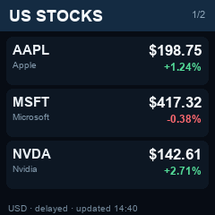

# Markets card

A two-page album card for Weather Clock:

- US stocks: AAPL, MSFT and NVDA
- Markets: gold and silver per troy ounce, copper per pound, and Bitcoin per coin

Prices are in USD. Each row shows the latest available price and its percentage move from the previous close. The footer labels the data as delayed and shows when the card was generated. Pages change every 10 seconds.



On a Mac, keep this folder in a permanent location and run `install.command [clock IP]`. It creates an isolated Python environment, uploads the first card and schedules refreshes every 15 minutes while the Mac is awake and the user is logged in. A failed quote request does not replace the last good card.

The quote symbols are `AAPL`, `MSFT`, `NVDA`, `GC=F`, `SI=F`, `HG=F` and `BTC-USD`. The script uses Yahoo Finance's public chart endpoint, which is not a contracted market-data feed and may change or apply delays. This display is informational, not trading data.

For a deterministic preview:

```sh
python3 -m venv .venv
.venv/bin/pip install Pillow
.venv/bin/python markets.py --sample --preview markets-preview.png
```
